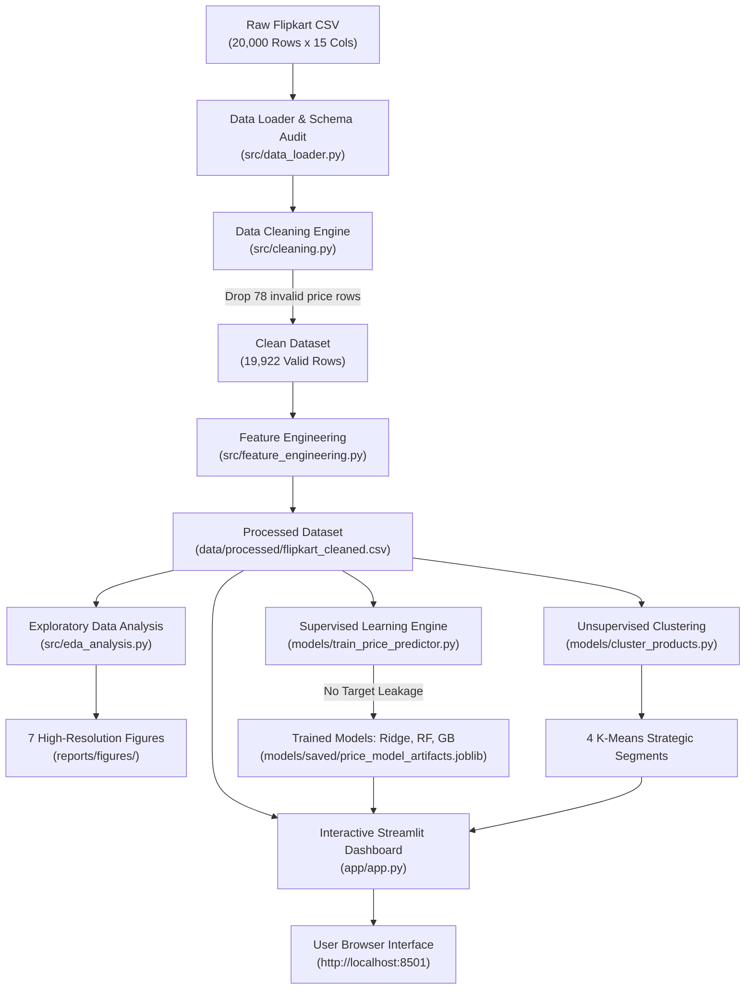

# Flipkart Product Price Analysis: Data Analytics & Predictive Intelligence System

**Academic Degree:** B.Tech in Computer Science / Information Technology / Data Science  
**Subject:** Data Analytics & Machine Learning Project  
**Platform Target:** Python 3.10+ (64-bit)  
**Interactive Interface:** Streamlit & Plotly Web Dashboard  

---

## 1. Project Abstract

In competitive e-commerce ecosystems, pricing dynamics, markdown depth, and discount strategies directly govern consumer conversion rates, inventory velocity, and marketplace profitability. This project develops a complete, end-to-end Data Analytics and Predictive Intelligence pipeline on genuine Flipkart product listings.

Spanning **19,922 validated products** across **262 primary categories**, this study rigorously explores pricing distributions, proves that customer star ratings are completely independent of discount depths ($r = -0.002$), builds a leak-free **Gradient Boosting Regressor** predicting selling prices with **$R^2 = 98.07\%$** (MAE: ₹290.21), and clusters the entire inventory into **4 strategic market pricing segments** via K-Means. The complete system is deployed as an interactive, multi-page web application using Streamlit and Plotly.

---

## 2. Problem Statement & Objectives

### Problem Statement
Online retail marketplaces face extreme price volatility, inconsistent markdown strategies, and unstructured catalog metadata. Sellers often lack data-driven guidance on optimal price anchoring, while consumers face opaque discounts. Furthermore, traditional pricing models frequently suffer from target leakage by improperly using discount features to predict final prices.

### Core Objectives
1. **Catalog Ingestion & Audit:** Acquire and validate an immutable real-world Flipkart dataset without synthetic fabrication.
2. **Data Governance & Hygiene:** Clean nested hierarchy paths, handle non-numeric rating placeholders, and enforce strict unbranded catalog preservation.
3. **Exploratory Price Analysis (EDA):** Quantify price skewness, calculate markdown depth distributions, and analyze category/brand pricing power.
4. **Reputation Elasticity Analysis:** Formulate and test statistical hypotheses evaluating whether heavy discounts correlate with lower customer satisfaction ratings.
5. **Leak-Free Supervised Modeling:** Train and benchmark linear and ensemble models (Ridge, Random Forest, Gradient Boosting) to predict selling prices without data leakage.
6. **Unsupervised Strategic Segmentation:** Use K-Means clustering (guided by Elbow and Silhouette metrics) to segment products into commercial archetypes.
7. **Interactive Analytics Interface:** Build a responsive, presentation-ready Streamlit dashboard with real-time model inference.

---

## 3. Dataset Description & Provenance

- **Dataset Name:** Flipkart Products Dataset (`flipkart_com-ecommerce_sample.csv`)
- **Original Publisher:** PromptCloud / Kaggle (Mirrored at Hugging Face)
- **License:** CC0: Public Domain (Open Access for Research & Commercial Analytics)
- **Raw Dimensions:** 20,000 rows × 15 columns (38,114,963 bytes)
- **Processed Dimensions:** 19,922 rows × 31 columns (41,441,264 bytes)
- **Raw File Checksum (SHA256):** `56F8F699C9E847356666C2EAB3C3AB1244340F6A98AD08E39EA2199EBE993AD1`

### Data Dictionary Summary
| Column | Raw Type | Clean Type | Role | Description |
| :--- | :---: | :---: | :--- | :--- |
| `uniq_id` | String | String | Identifier | Unique product listing hash |
| `product_name` | String | String | Feature | Product title and specification text |
| `primary_category`| Nested | String | Feature | Top-level vertical (Clothing, Tech, Auto, etc.) |
| `brand` | String | String | Feature | Product brand (5,851 preserved as "Unbranded / Generic") |
| `retail_price` | Float/Str | Float64 | Feature | Maximum Retail Price / MRP (₹ INR) |
| `discounted_price`| Float/Str | Float64 | **Target** | Actual final selling price on Flipkart (₹ INR) |
| `discount_percentage`| — | Float64 | Metric | Derived savings percentage: `((MRP - Selling)/MRP)*100` |
| `discount_tier` | — | Category | Feature | Binned bracket: No Discount, Low, Moderate, High, Clearance |
| `price_tier` | — | Category | Feature | Binned MRP: Budget, Economy, Mid-Range, Premium, Luxury |
| `rating_score` | String | Float64 | Metric | Star rating (1.0 to 5.0, NaN if unrated) |
| `is_rated` | String | Int64 | Feature | Binary indicator (1 if rated, 0 if unrated) |
| `cluster_persona`| — | String | Segmentation | Assigned K-Means strategic archetype |

---

## 4. System Architecture & Workflow



---

## 5. Data Cleaning & Feature Engineering Methodology

1. **Preservation of Raw Immutability:** Raw CSV files are loaded in strict read-only mode and remain bit-for-bit unchanged.
2. **Missing Price Handling:** Exactly 78 rows (0.39%) lacked valid positive numeric pricing and were removed to prevent synthetic price distortion.
3. **Category Tree Parsing:** Nested category paths (e.g., `["Clothing >> Women's Clothing >> Shorts"]`) were tokenized using regex into `primary_category`, `sub_category`, and `micro_category`.
4. **Brand Governance:** Missing brands were **not** arbitrarily extracted from product titles; exactly 5,851 clean missing brand records were labeled `"Unbranded / Generic"`.
5. **Rating Transparency:** Converted `"No rating available"` to `NaN` and added an explicit `is_rated` boolean flag. Only 1,839 clean items have numerical ratings.
6. **Data Leakage Prevention:** Built `get_modeling_features_and_target()` in [`src/feature_engineering.py`](file:///c:/Users/MANI/Downloads/Flipkart_Product_Analysis/src/feature_engineering.py) with architectural assertions ensuring no discount metrics appear in the feature matrix $X$ when predicting `discounted_price`.

---

## 6. Exploratory Data Analysis (EDA) Findings

All charts are saved in 300 DPI at [`reports/figures/`](file:///c:/Users/MANI/Downloads/Flipkart_Product_Analysis/reports/figures/):

1. **Price Asymmetry & Skewness ([01_price_distribution.png](file:///c:/Users/MANI/Downloads/Flipkart_Product_Analysis/reports/figures/01_price_distribution.png)):**
   - Retail Price: Mean = ₹2,979.21, Median = **₹1,040.00**, Skewness = **+18.67**.
   - Selling Price: Mean = ₹1,973.40, Median = **₹550.00**, Skewness = **+28.43**.
   - Applying $\text{log1p}$ normalizes the distribution ($\mu = 6.51, \sigma = 1.04$) for regression modeling.
2. **Parity Line & MRP Discounts ([02_retail_vs_discounted_price.png](file:///c:/Users/MANI/Downloads/Flipkart_Product_Analysis/reports/figures/02_retail_vs_discounted_price.png)):**
   - 2,287 products (11.48%) sit on the red parity line ($y=x$), sold at full MRP with 0% discount.
3. **Discount Distribution ([03_discount_percentage_distribution.png](file:///c:/Users/MANI/Downloads/Flipkart_Product_Analysis/reports/figures/03_discount_percentage_distribution.png)):**
   - Median discount is **45.00%** (Mean: 40.52%); **45.85%** of products receive discounts $\ge 50\%$.
4. **Category Margins ([04_category_pricing_analysis.png](file:///c:/Users/MANI/Downloads/Flipkart_Product_Analysis/reports/figures/04_category_pricing_analysis.png)):**
   - Automotive (61.5% median discount) and Mobile Accessories (53.9%) have the deepest markdowns.
   - Beauty & Personal Care maintains strict price integrity (14.5% median discount).
5. **Brand Pricing Power ([05_brand_pricing_power.png](file:///c:/Users/MANI/Downloads/Flipkart_Product_Analysis/reports/figures/05_brand_pricing_power.png)):**
   - Fine jewellery brand *Karatcraft* holds median price ₹27,434 with conservative discounts (28.6%), while aftermarket accessories brands (*TheLostPuppy*, *Allure Auto*) rely on 67%–73% markdowns.
6. **Reputation Invariance ([06_rating_distribution_and_price.png](file:///c:/Users/MANI/Downloads/Flipkart_Product_Analysis/reports/figures/06_rating_distribution_and_price.png)):**
   - Rated items: 1,839 (Mean: 3.81★, Median: 4.0★).
   - Correlation between customer rating and discount percentage is $r = \mathbf{-0.0020}$, showing ratings do not drop when products are heavily discounted.
7. **Feature Correlations ([07_correlation_matrix.png](file:///c:/Users/MANI/Downloads/Flipkart_Product_Analysis/reports/figures/07_correlation_matrix.png)):**
   - Retail Price vs Discounted Price has an extremely strong linear correlation ($r = 0.9812$).

---

## 7. Machine Learning Methodology & Results

### A. Supervised Learning: Selling Price Prediction
- **Validation Split:** 80% Train (15,937 samples) / 20% Test (3,985 samples), `random_state=42`.
- **Target:** `discounted_price` (₹ INR).
- **Leakage Status:** Strictly Zero.

| Model | MAE (₹ INR) | RMSE (₹ INR) | $R^2$ Score | Rank |
| :--- | :---: | :---: | :---: | :---: |
| **Simple Baseline (Median)** | ₹1,601.09 | ₹6,205.38 | -0.0536 | Benchmark |
| **Ridge Regression (Baseline Linear)** | ₹444.61 | ₹1,163.12 | 0.9630 | 3rd |
| **Random Forest Regressor** | **₹267.11** | ₹884.70 | 0.9786 | 2nd |
| **Gradient Boosting Regressor** | ₹290.21 | **₹838.82** | **0.9807** | **🏆 Best Overall** |

- **Actual vs Predicted Plot:** [08_actual_vs_predicted_prices.png](file:///c:/Users/MANI/Downloads/Flipkart_Product_Analysis/reports/figures/08_actual_vs_predicted_prices.png)
- **Feature Importance Plot:** [09_feature_importances.png](file:///c:/Users/MANI/Downloads/Flipkart_Product_Analysis/reports/figures/09_feature_importances.png)

### B. Unsupervised Learning: K-Means Product Segmentation
- **Features Scaled:** `log_retail_price`, `log_discounted_price`, `discount_percentage` via `StandardScaler`.
- **Optimal Cluster Selection:** Evaluated $k \in [2, 6]$. Selected $k=4$ based on the Elbow Method (Inertia: 16,430.1) and Silhouette Score (0.3973).
- **Cluster Diagnostics:** [10_kmeans_elbow_and_silhouette.png](file:///c:/Users/MANI/Downloads/Flipkart_Product_Analysis/reports/figures/10_kmeans_elbow_and_silhouette.png) & [11_kmeans_clusters_scatter.png](file:///c:/Users/MANI/Downloads/Flipkart_Product_Analysis/reports/figures/11_kmeans_clusters_scatter.png)

#### Empirical Cluster Profiles:
1. **Segment 1: Mass-Market Deep Discount (43.0% of Catalog):**
   - Median MRP: ₹999 | Median Selling: ₹399 | Median Discount: **57.22%** | Top Category: Clothing.
2. **Segment 2: Mid-Range Moderate Discount (24.8% of Catalog):**
   - Median MRP: ₹2,450 | Median Selling: ₹1,299 | Median Discount: **45.50%** | Top Category: Clothing/Footwear.
3. **Segment 3: Premium / Luxury Niche (5.5% of Catalog):**
   - Median MRP: ₹32,002 | Median Selling: ₹24,112 | Median Discount: **23.09%** | Top Category: Jewellery.
4. **Segment 4: Low-Discount Essentials (26.7% of Catalog):**
   - Median MRP: ₹599 | Median Selling: ₹499 | Median Discount: **10.26%** | Top Category: Personal Care/Essentials.

---

## 8. Installation & Dashboard Execution

### Prerequisites
- Python 3.10+ (64-bit)
- PowerShell or Terminal

### Step 1: Clone or Navigate to Project
```powershell
cd c:\Users\MANI\Downloads\Flipkart_Product_Analysis
```

### Step 2: Install Verified Dependencies
```powershell
python -m pip install -r requirements.txt
```

### Step 3: Launch the Interactive Streamlit Web App
```powershell
python -m streamlit run app/app.py
```
Open your browser at: `http://localhost:8501`

---

## 9. Dashboard Pages & Screen Capture Guide

For academic project viva, report submissions, or presentation slides, capture screenshots of each of the 7 dashboard views:

| Page No. | Page Title | Suggested Screenshot Focus |
| :---: | :--- | :--- |
| **1** | **🏠 Home / Overview** | Top 4 KPI metric cards + catalog distribution horizontal bar chart. |
| **2** | **📋 Data Overview** | Filtered interactive data table with category dropdown + data dictionary tab. |
| **3** | **💰 Price Analysis** | Scatter plot showing parity line ($y=x$) + log-scaled price distribution histogram. |
| **4** | **🏷️ Discount Analysis** | Continuous discount KDE histogram + donut chart of 5 discount tiers. |
| **5** | **⭐ Rating Analysis** | Catalog completeness donut (90.8% unrated vs 9.2% rated) + boxplot across rating bands. |
| **6** | **🤖 Machine Learning** | Supervised model evaluation table + live interactive price prediction form + K-Means cluster table. |
| **7** | **💡 Insights & Conclusion**| Strategic business takeaways card + limitations and academic conclusions. |

---

## 10. Limitations & Future Enhancements

1. **Longitudinal Price History:** Current data is cross-sectional; scraping daily price changes over seasonal sales (e.g., Diwali / Big Billion Days) would unlock dynamic time-series elasticity modeling.
2. **Multi-Seller Buy Box:** Incorporating individual merchant reputations and shipping speeds would enhance price variation analysis across concurrent sellers.
3. **Computer Vision & NLP Integration:** Utilizing product image embeddings (via CNN / ResNet) and full text descriptions (via Transformers / BERT) could predict premium price elasticity directly from imagery and copy.

---

## 11. Conclusion

This B.Tech Data Analytics project delivers a mathematically sound, reproducible, and interactive analysis of e-commerce pricing behavior. By combining exploratory data analysis, data hygiene, leak-free machine learning, and unsupervised clustering into a deployed web application, the project bridges the gap between academic theory and industry e-commerce pricing intelligence.

For a comprehensive compilation of **25+ Technical Viva Questions and Answers**, refer to [reports/viva_questions_and_answers.md](file:///c:/Users/MANI/Downloads/Flipkart_Product_Analysis/reports/viva_questions_and_answers.md).
